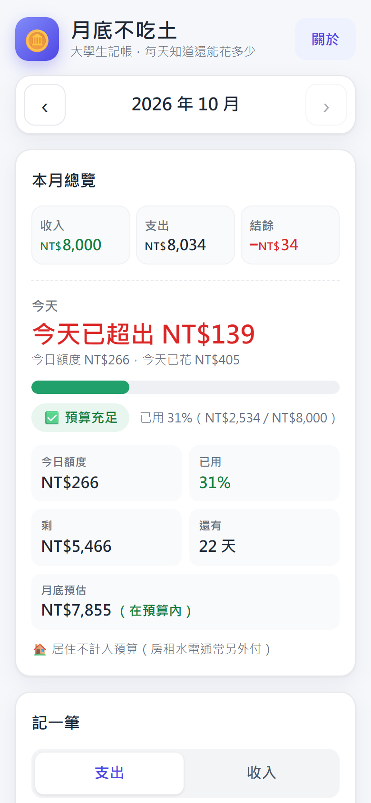
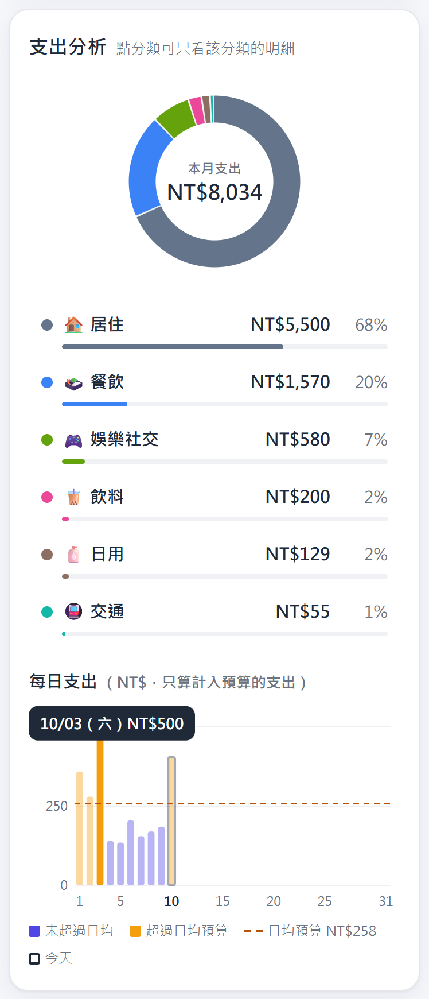
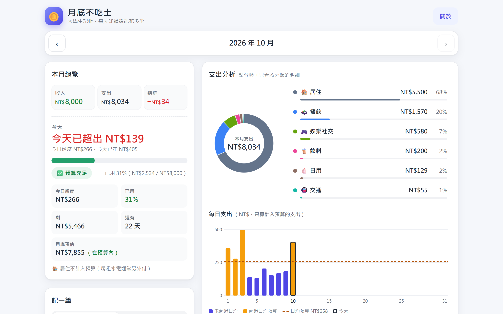

# 💸 月底不吃土

> 幾秒記好一筆，一眼看懂錢花到哪裡，每天知道「今天還能花多少」，月底不爆預算。
>
> *No-Broke Student Budget Tracker — a single-file, zero-dependency expense tracker for university students (Traditional Chinese UI, runs fully offline in the browser).*

🔗 **線上試用**：https://danghung2402.github.io/hw5-expense-tracker/

---

## 功能一覽

| 編號 | 功能 | 說明 |
|---|---|---|
| F-01 | 快速記一筆 | 支出／收入切換，金額、分類按鈕、今天／昨天日期快選、備註，Enter 即新增 |
| F-02 | 明細清單 | 依日期分組列出當月紀錄，空月份顯示引導與「載入範例資料」 |
| F-03 | 編輯、刪除與復原 | 編輯視窗修改任何欄位，刪除後 5 秒內可復原（鍵盤也可操作） |
| F-04 | 月份切換與本月收支摘要 | 上／下個月、回到本月，顯示本月收入、支出、結餘 |
| F-05 | 月預算、變色進度條與「今天還能花」 | 設定月預算，進度條依用量變色，每天算出今日額度與月底預估 |
| F-06 | 圖表 | 分類甜甜圈圖與排行、每日支出長條圖（純 SVG），點分類可連動篩選清單 |
| F-07 | 篩選與搜尋 | 依收支類型、分類、關鍵字篩選明細 |
| F-08 | 自動儲存與錯誤處理 | 每次變更即寫入 localStorage；資料損毀或無法儲存時以橫幅提示，並同步多分頁 |
| F-09 | 匯出 CSV、JSON 備份與匯入 | 匯出 CSV／JSON，匯入前驗證格式與日期並給出明確錯誤訊息 |
| F-10 | 範例資料與清除全部 | 一鍵載入範例資料方便試用，也可清除全部資料 |
| F-11 | 響應式版面與操作回饋 | 手機單欄、桌機兩欄，可點元素 ≥ 44px，提示訊息可朗讀，全程可用鍵盤操作 |
| F-12 | 關於／版本紀錄 | 顯示版本與修改紀錄，可開關「顯示功能編號」對照規格 |

## 畫面截圖

**手機版總覽**

**圖表（甜甜圈圖與每日長條圖）**

**桌機版（兩欄）**

## 規格書

完整規格（動機、F-01～F-12 的描述與驗收標準、介面、資料結構、測試情境）請見 **[spec.md](spec.md)**。

## 開發過程（Vibe Coding × AI）

這個專案全程以「和 AI 對話」的方式完成，並保留每一步的紀錄：

1. **規格討論**：從一句話構想出發，和 AI 從「使用者體驗、資料邏輯、評分標準」三個角度討論，整理成規格書。→ [`process/01_規格討論紀錄.md`](process/01_規格討論紀錄.md)
2. **AI 測試回饋與修改**：每一版完成後，由多組 AI 依規格書的驗收標準逐項測試（驗證修正、回歸、視覺、規格對照等），回報問題；確認屬實的修正程式並同步更新規格書，不採納的也記下原因。共進行 2 輪。→ [`process/02_AI測試回饋與修改紀錄.md`](process/02_AI測試回饋與修改紀錄.md)
3. **版本檔案**：每一版的 `index.html` 都保留在 [`versions/`](versions/)（`index_v1.html`、`index_v1.1.html`、`index_v1.2.html`），方便對照每輪修改前後的差異。根目錄的 `index.html` 即最新版 v1.2。

## 技術

- **單一檔案**：整個 App 就是一個 `index.html`，下載後雙擊即可使用
- **原生 JavaScript**（vanilla JS），不使用任何框架或套件
- **SVG 圖表**：甜甜圈圖與每日長條圖皆為手寫 SVG，無圖表函式庫
- **localStorage** 儲存資料，只存在使用者自己的瀏覽器裡
- **無外部請求**：不載入外部字型、腳本或 API，不收集任何資料，離線也能用

## 版本紀錄

### v1.2（2026-10-10）

依 AI 測試回饋修正：第 2 輪由 4 組 AI 測試（驗證修正、回歸、視覺、規格對照）回報 19 項，合併重複後 16 項不同問題，採納並修正 12 項，其餘 4 項評估後不改（原因記在測試紀錄）。規格書同步升為 v1.2。

- 【F-03】另一個分頁改了資料時，已失效的「復原」提示會一併收起，不再留下按了沒反應的按鈕；連點「編輯」後游標仍留在金額欄
- 【F-01】快速連點「記一筆」，成功儲存後不會再跳出紅色金額錯誤
- 【F-08】儲存失敗的橫幅被關掉後，下一次儲存仍失敗會再次顯示
- 【F-06】手機旋轉或縮放視窗後，已點選的長條提示框與焦點會保留；長條圖的朗讀文字加入日均預算金額；規格補上「<1%」的寫法
- 【F-05】今天已超出或本月已超支時，卡片標籤改為「今天」「本月預算」，不再與「今天還能花」互相矛盾
- 【F-04】負 10 萬以下的結餘（如 −NT$123,456）在 360px 手機不再超出格子
- 【F-12】補記 v1.1 實際做了但漏記的 3 項修改（F-01 備註截斷、F-03 其他提示取代「復原」、F-05 清空預算欄不閃紅字）

### v1.1（2026-10-10）

依 AI 測試回饋修正：9 組 AI 測試（共 1,980 項檢查）回報 103 項問題，確認屬實的已修正，規格書同步升為 v1.1。最重要的兩項：照規格 T-6-4 重新整理後，黃色橫幅被捲到畫面外；快速連點「刪除」會連刪兩筆。

- 【F-08】重新整理後橫幅一定看得到（不再被捲到畫面外）；另一個分頁改了資料會自動同步，不再被舊資料蓋掉
- 【F-03】連點「刪除」「編輯」不再連刪或誤觸；拖曳選字放開在視窗外不會關掉編輯視窗；用鍵盤刪除後焦點直接移到「復原」，焦點在提示上時 5 秒計時暫停；其他提示訊息會取代「復原」提示，復原一併失效
- 【F-04】手機窄螢幕 NT$12,000 不再斷成兩行；月份列、明細日期標題、匯出按鈕在 360px 不再折行；回到本月後焦點不再消失
- 【F-05】月底預估改為先乘後除（避免 .5 差 1 元）；剛好用完預算時「NT$0」改為紅字；預算欄清空時不再閃紅色錯誤
- 【F-06】甜甜圈中央總額依位數縮小，不再壓到圓環；百分比加總恰為 100%；日均預算金額改放圖例，圖例只列出實際有畫的項目；再點一次已選分類可取消篩選；Y 軸刻度與提示框位置修正；縮放視窗不再造成水平捲軸或 ResizeObserver 警告
- 【F-07】點排行或圓餅會清掉舊關鍵字；注音輸入組字中不再即時篩選；操作後焦點留在明細標題
- 【F-09】匯入拒絕未來日期；無法儲存時不再顯示「匯入成功」；匯入訊息不再殘留
- 【F-10】範例資料每月都有「飲料．珍奶」讓 T-5 可操作；週六是今天時也有娛樂社交；今天的範例紀錄不再比現在晚；日均落在約 NT$250–260，不再月月爆預算；清除全部資料同時重設篩選
- 【F-01】備註以「字」計算（emoji 算 1 字），超過 30 字自動截斷（不再用 maxlength）
- 【F-11】桌機剛好兩欄（約 900–1,040px）時排行與搜尋框不再被擠壓；對比不足的 3 組文字配色加深；加上左右安全區邊界；說明文字避免孤字
- 【F-12】顯示功能編號時頁首標籤不再被切掉；版本紀錄改為條列

### v1.0（2026-10-10）

一句話構想 → 和 AI 從使用者體驗、資料邏輯、評分標準三個角度討論，整理成規格書 v1.0。

依規格書完成初版：快速記一筆、明細清單、編輯／刪除／復原、月份切換與收支摘要、月預算與「今天還能花」、SVG 圓餅圖與每日長條圖、篩選搜尋、自動儲存與錯誤處理、CSV／JSON 匯出匯入、範例資料、響應式版面、關於面板。
